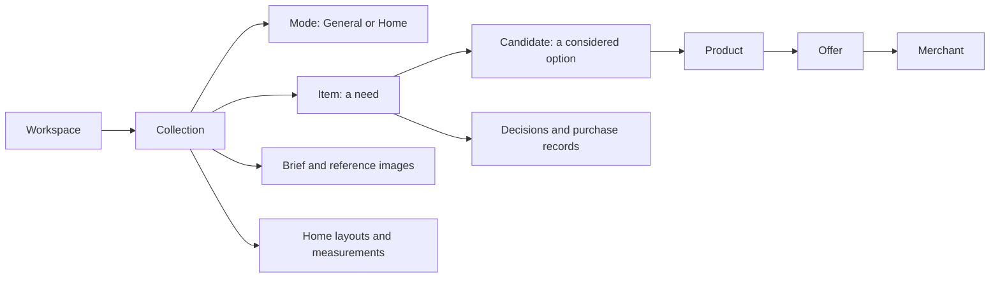

# HopKit general planning architecture

Updated 2026-10-24. Design and tasks 1–3 (mode settings, neutral collection shell, Home composition/shared brief) are complete locally. Release remains deferred at the user's request. General is the default experience, Home is a collection mode, and Food follows after the shared foundation works. Mode selection is optional for users; generalizing the app is the selected product direction. See [the combined checkpoint](./HOPKIT_COMBINED_HANDOFF.md) for current validation and Git approvals; older checkpoints below are historical.

## Product boundary

One WantKit workspace may contain a Home living-room collection, a General laptop shortlist, and a future Food weekly plan. Shared planning covers needs, alternatives, retailer facts, discussion, budgets, and human decisions. The initial redesign remains centered on purchases and household planning; calendars, arbitrary task management, travel bookings, and service procurement would need a separate scope decision.

**Planning addendum, 2026-10-23:** the user requested a lightweight [Life Planner](./LIFE_PLANNER.md) roadmap covering flexible routines, exercise, personal tasks and links to shopping/Food. This is a bounded future scope, not implementation approval or an expansion of the General/Home release. Normal/Busy/Emergency describe daily capacity, not Collection modes. Reuse the existing records and keep purchase completion separate from personal task completion; a full calendar and general project-management system remain outside this plan.

Keep the existing app, backend, identity, and deployment. Evolve the shared model and UI in stages. Home behavior becomes a composed part of the app; it does not determine every collection's navigation. Food will have genuine domain rules beyond a different set of labels.

## Shared model

| Concept | Shared responsibility | Mode boundary |
| --- | --- | --- |
| Workspace / membership | Collaboration and access scope | Modes never grant access or transfer records |
| Collection | One planning effort with stable identity | One selected mode; collections in a workspace may differ |
| Item | The need, quantity, priority, constraints, budget, deadline and status | Specialized demand belongs in typed extensions when needed |
| Candidate | Links an Item to a Product; notes, preferences and planned selection | User-facing copy may say “option”; keep Candidate identifiers/contracts |
| Product | Workspace-private identity, brand, photo and attributes | Product category does not select the Collection mode |
| Offer / Merchant / Price Check | Seller, price kind, shipping, availability and observed time | Keep facts and freshness separate from the need and decision |
| Brief / reference images | Goals, constraints, references and visual guidance | Home adds layouts/design emphasis; General still supports images |
| Decision / recorded purchase | Explicit actor action and historical evidence | Mode switches never choose a product, change status, or rewrite history |

Items may have no Candidates. Unknown prices remain unknown. Existing EUR budgets and positive integer quantities remain unchanged in General/Home. One Product may be considered in multiple Items through separate Candidates; each plan remains local to its Item. Changing a mode does not regroup the existing catalogue.

## What the current code requires

- `packages/domain/src/planning.ts`, `decision.ts`, and `quantity.ts` already provide purchase planning independently of rooms. Both demand and purchase quantities are positive integer counts.
- `packages/contracts/src/index.ts` defines strict Collection resources, briefs, and context snapshots. `apps/web/src/db/schema/context.ts` and `worker/context-service.ts` currently accept snapshot version 1 only. Adding a field to the reused Collection schema would affect old snapshots and clients.
- `PlanningDashboard.tsx` always lists Items, Brief & images, Floor plans, and Budget, and loads brief/concept/media/rollup together with Items. An ancillary failure can affect the main loading state. That coordination needs to become mode-aware and independently recoverable.
- Home presentation is concentrated in `CollectionDirection.tsx`, `collection-direction-forms.tsx`, `FloorPlans.tsx`, palette fields, and localized examples. Reference media itself is reusable.
- `core-workspace-service.ts` guards Collection edits through `collection_content_edit`; existing collection/workspace access and archived-resource checks must apply to mode edits too.

## Navigation and interaction

Keep Workspace → Collections in the sidebar. Show a small mode label in collection settings, with General selected when creating a collection. Changing the mode is an explicit collection edit; authorized Editors and Owners may do it. Viewers and Contributors cannot change it. Food is not selectable before its workflow exists.

| Experience | Primary views | Supporting controls |
| --- | --- | --- |
| General | Items, Brief & references, Budget | Comparison inside an Item; discussion/history inside details |
| Home | Items, Brief & images, Floor plans, Budget | Design preferences, layouts and measurements |
| Food — later | Shopping list, Meals, Pantry | Recipes, serving counts and ingredient coverage; detailed design deferred |
| Activity — later | Event shortlist, Plan, Budget (proposed) | Concerts, shows, art exhibitions and outings; dates, venues, ticket links and companions; detailed design deferred |

The core brief foregrounds goal, requirements, exclusions, budget and reference links/images. Materials, brands and colors remain available as optional preferences; Home makes design controls easier to find. General collections do not need a room, floor plan, concept narrative, photo, Offer, or price before they are usable.

Preserve the compact detail dialog, large-photo viewer, retailer links, and horizontal comparison. Use neutral examples for General onboarding and room examples for Home. Preserve English/Farsi, RTL, appearance preferences, keyboard focus and existing selection URLs. Do not add another global dashboard or duplicate the sidebar for each mode.

When switching Home → General, retain all layouts, palette values, brief fields and reference files. If Home content exists, provide “Saved Home details” under collection tools even in General; switching back restores the normal Home views. Do not infer a mode from names, merchant, images, or product categories. An unsupported future mode should show the shared read experience and an explanatory message, with mode-specific writes disabled; it must not silently overwrite the saved mode.

## Implementation boundaries

Use a small static General/Home registry in the existing packages. Domain code owns mode identifiers and validation; contracts own settings input/output; server services own permission checks and persistence; React owns mode presenters and navigation. Keep the shared Items, commerce, budget, media and collaboration services. Home components compose those services with their existing layout/design modules.

Introduce a dedicated Collection-mode settings resource instead of immediately extending `CollectionResource`. Proposed storage is an additive `collection_mode_settings` table keyed by Collection, with the existing Workspace/Collection relationship enforced, a supported mode value, revision, updating actor and timestamp. This isolates rollout from strict historical exports. The settings resource is shared across REST and MCP actions; both invoke the same service. Mode is presentation/workflow configuration, not an authorization mechanism.

Write contracts accept only implemented mode identifiers. Read contracts retain a validated unknown identifier so an older client can display the shared fallback without failing the whole Collection response; it cannot reinterpret or write mode-specific content. Any future storage constraint widening is a separate additive migration.

New collection creation writes General settings by default, or Home if explicitly selected, atomically with the collection creation. An existing collection without settings keeps the current Home experience until an authorized user selects a mode; the UI identifies this as preserved legacy behavior. This avoids hiding existing content or performing an unreviewed bulk reclassification. Older clients that omit mode still create new General collections through the new service. Returning through an old Worker version keeps existing records readable; its newly created collections lack settings and retain legacy behavior on re-upgrade.

Mode edits recheck archive state and scope permissions in the write operation, require the expected settings revision, and return a conflict for stale edits. The settings record captures the latest mode actor/time; a dedicated full collection-settings history can be considered separately. Existing Item history stays untouched. Read access to any retained Home files continues to use their existing authorization checks.

Keep v1 context exports unchanged in the first slice. Assistants can use the new bounded mode-settings tools when they need the mode. Explicitly adding mode or future typed food data to an export later requires a new snapshot version, readers for old versions, and a reviewed change to the database constraint that currently permits only version 1. Historical immutable exports are never rewritten. Do not send hidden cross-collection context to assistants.

## Food boundary

A grocery purchase list can use the existing count-based model, but meal planning needs Recipe, IngredientRequirement, MealAssignment, PantryStock and ShoppingListLine concepts. Ingredient demand such as 500 g rice differs from an Offer for a 1 kg bag. Serving scaling, pantry subtraction, compatible unit conversion and overlapping demand aggregation must be explicit. Retain unsupported conversions as unresolved rather than inventing coverage.

Later Food work will model measured amounts independently of current integer purchase quantities. Buying a package records a purchase; it does not imply the ingredient was consumed or the meal completed. Repeated weekly shopping requires separate planning runs/lines instead of resetting historical purchased Items. No recipe parser, nutrition guidance, automatic reorder, new food schema or separate Food app is included in the General/Home implementation.

## Activity mode — future idea

Added at the user's request on 2026-10-05: plan concerts, shows, art exhibitions and other outings. Later design can cover an event shortlist, date/time and venue, ticket links/prices, companions, notes and a plan for attending. Calendar/reminder integrations and ticket booking need their own scope decisions. This is a deferred mode idea alongside Food, with priority to be decided later; it does not add a selectable mode, schema or implementation task to the current General/Home work.

## Ordered implementation tasks

Work on one task per session; commit/push/release keep their existing approval gates. Each task ends with focused validation and a handoff before the next is started.

1. [x] **Mode settings foundation — complete locally, 2026-10-04.** Add pure domain identifiers, dedicated contracts, additive settings migration, shared server service/REST and bounded MCP tools. Integrate new-collection defaults and explicit mode edits. Completion: General/Home settings persist; old Collection and v1 export contracts remain intact; legacy/no-settings behavior, cross-scope access, archived state and stale revisions are tested. No automatic data reclassification.
2. [x] **Neutral collection shell — complete locally, 2026-10-04.** Introduce the small presenter registry and settings control; separate primary Item loading from brief/media/budget errors; select views by effective mode. Completion: new General and Home collections work, existing collection URLs still resolve, independent failures are retryable, and English/Farsi, theme, keyboard and mobile behavior pass focused checks.
3. [x] **Home composition and shared brief — complete locally, 2026-10-24.** Common brief/references remain shared; Home narrative is composed separately. General leads with goals, requirements, exclusions and budget, with optional design preferences and a keyboard-accessible Saved Home details disclosure. Synthetic browser Home → General → Home checks preserve the edited brief, materials, brands, palette and concept access; floor plans load on demand. Desktop/mobile, English/Persian, light/dark and Escape checks pass. Existing planning, comparison and purchase services remain unchanged; no Items moved or merged. Full combined quality gate: 387 tests, build and dry-runs. See the combined handoff for evidence and the later one-token CSS correction.
4. **Release the General/Home redesign.** Run the normal gate and preview-first rollout with fictional fixtures, then the approved production release preserving live settings. Completion: new-collection flow, mode round trip, scoped invitations, planning reads and connector contracts pass; recovery versions are recorded. Further catalogue auditing stays deferred.
5. **Food design, then implementation tasks.** Request a separate task for measured ingredients, recipes, weekly meal planning, pantry and merged shopping lists after General/Home is usable. Define those acceptance examples before creating schema.

## Migration and verification

Add the settings table before deploying code that reads it. Rehearse on a local database with old collections and v1 snapshots, then preview. Existing IDs, memberships, offers, prices, image URLs/files, purchase quantities and decision history must compare unchanged. The initial rollout has no destructive schema changes, catalogue grouping, bulk record updates or currency conversion. An old-code rollback retains the additive table/settings; avoid deleting it or restoring production data merely to revert UI code.

Strict old exports deserve explicit regression coverage. Include an old-client create request without mode, a legacy collection without a settings row, a new General collection without optional assets, a Home collection with existing files, a denied cross-collection settings read, a denied Contributor edit, archived resource handling, conflicting mode edits, and a complete mode round trip. Future Food acceptance should include compatible and incompatible units, pantry shortages and repeated shopping histories.

No new paid service, provider call, monitoring, or separate deployment is needed for General/Home. Preserve the existing log sampling and storage limits. Load optional panels on demand where possible and avoid letting an optional panel error block Items. Measure query changes during implementation; this design task does not estimate bills or perform live queries.

Current platform references consulted for the rollout design: [D1 migrations](https://developers.cloudflare.com/d1/reference/migrations/) and [Worker versions and deployments](https://developers.cloudflare.com/workers/versions-and-deployments/). These describe separately versioned database migrations and Worker code; the compatibility/rollback policy above is the project's design decision.

## Design checkpoint — 2026-10-04

The user proposed GPT-6.1 Sol with High reasoning. It is suitable for this bounded architecture task: schema compatibility, migration behavior and ownership require care. The actual UI model selector could not be independently verified. Check model suitability, reasoning effort, scope and validation cost before each subsequent task; routine documentation/copy changes may use less reasoning. No subagents or repository copies are needed.

The design checkpoint completed the glossary and implementation order without runtime changes. The subsequent implementation checkpoint below completes task 1. Task 2 starts only on the user's next request.

## Foundation implementation checkpoint — 2026-10-04

Task 1 is complete in the current folder. `collection_mode_settings` is an additive table introduced by migration `0017_collection_mode_settings.sql`; its Drizzle snapshot/journal belong in the same commit. No existing migration or Collection/v1-export resource was widened. New Collections atomically receive General settings unless explicitly created with Home. Reads distinguish `legacy` (no saved mode, effective Home, revision 0), `configured` and `unsupported` (retained future identifier, effective General, editing disabled). Future storage identifiers still require an explicit migration widening the General/Home constraint.

Authenticated `GET /api/collections/:collectionId/mode` returns settings and `permissions.canEdit`; `PATCH` accepts `{ mode, expectedRevision }`. Editors/Owners may edit using existing `collection_content_edit`, with scope and archive guards rechecked inside the write and conflicts for stale revisions. Mode changes only touch the settings table. MCP `read_collection_mode` is a bounded scoped read; `update_collection_mode` uses the same service through the existing approval/receipt flow. Its approval target includes current mode settings; revision validation stays in the write service so successful receipt reads/replays work after the revision advances. Existing collection-create MCP inputs optionally accept mode; generic Collection PATCH cannot bypass the revision guard.

The UI still uses the current Home presentation until task 2 integrates settings. Keep the migration and code together, apply the additive migration before code rollout, and preserve live settings during the later preview-first release. No deployment or live product writes occurred. Local `.tmp/` artifacts are ignored and preserved; design and audit documentation should be retained as durable history.

Validation: all gate components passed across the recorded runs: lint/types/schema metadata, 334 tests, production build and dry-run. Tests include populated old-schema migration/rollback, unchanged v1 snapshots and planning/media/history rows, atomic creation rollback and write-time access/archive guards, concurrent edits, bounded MCP access, required approval, stale approval and successful receipt replay. No live migration, deployment, commit or push. The generated schema diff adds exactly one table and changes no existing table.

## Collection shell checkpoint — 2026-10-04

Task 2 is complete locally. New-collection forms default to General and offer Home; existing collections expose a compact mode control only when settings permissions allow editing. A static presenter registry selects General’s Items / Brief & references / Budget navigation and Home’s additional Floor plans view. Legacy collections retain Home until explicitly changed; unsupported identifiers retain the shared fallback with mode and Home-concept editing disabled. English/Farsi examples follow the selected mode.

Items load independently. Mode settings and Budget have separate request/retry state; brief, concept and images load only when their view is opened, each with its own error boundary and retry. Late responses and mutation results from another collection cannot replace current data. Successful concept saves no longer fail merely because the subsequent media refresh fails. Conflict recovery refreshes the reviewed revision and form without remounting the dialog, preserving keyboard focus; refreshing or read failure leaves Cancel usable.

Fictional fixture counters confirm three initial collection reads (Items, mode, Budget), versus the former five bundled reads; opening references adds three independent reads. Retrying one failed panel makes one read and does not reload Items or healthy sibling panels. This is local request-count evidence, not a production billing estimate. No polling, dependencies, bindings, live data changes or deployment were added.

Validation: lint and TypeScript; 80 UI tests and five localization tests; production build and deployment dry-run; browser checks for General/Home creation, preserved collection query URLs, independent Budget/brief/media recovery, delayed cross-collection responses, stale mode saves, legacy Home → General → Home navigation, read-only/future-mode fallback, keyboard focus/Escape, light/dark appearance, desktop English and mobile Farsi/RTL at 390 px without overflow. A fresh page has no console errors; development hook edits required a full reload of the temporary harness. Existing bundle-size/local-secret build notices remain. Evidence stays ignored under `.tmp/collection-shell-*` and `.tmp/mode-shell-qa/`.

Task 3 is next: compose a common brief/references experience and Home design tools, including the retained Home-content entry while in General. This slice intentionally still reuses the existing direction content inside the neutral navigation. Migration 0017 and the settings foundation remain uncommitted and undeployed alongside this UI. Do not release before task 3 and the normal preview-first gate.
